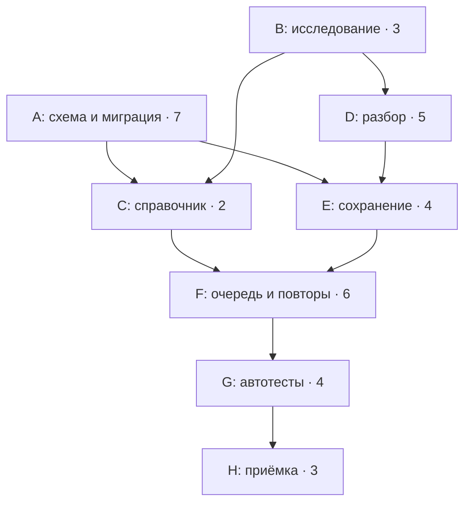

# Лабораторная 5, пункт 9 — зависимости и критический путь

Расчёт на **12.11.2026**. До начала проверена публикация пункта 8: `project/main` — `2532465`, `project.wiki/master` — `ace9c08`; оба совпадают с локальными HEAD. Полный каталог зависимостей — [dependencies-step9.json](dependencies-step9.json), воспроизводимые входы и результаты CPM — [cpm-step9.json](cpm-step9.json).

## Связи в GitHub

В [Project № 1](https://github.com/users/unlaesh/projects/1) добавлены **127 нативных связей blocked by / blocking**. Их направления проверены: предшественник блокирует последующую задачу. В исходной выгрузке таких связей не было. Граф ацикличен; новые Issues не создавались. Описания, Estimate, Priority, исполнители, статусы и майлстоуны сохранены.

Создано табличное представление **[Blocked Tasks](https://github.com/users/unlaesh/projects/1/views/7)** с фильтром **`is:blocked`**. На момент проверки 41 открытая карточка зависит хотя бы от одной незавершённой карточки. Метка `blocked` не требуется: используются реальные связи GitHub. Закрытые предшественники #17/#26 учитываются как уже выполненные результаты.

Нативная связь означает зависимость готовности карточки; GitHub не хранит в ней тип сетевой связи или задержку. В нашем каталоге различаются **87 Finish-to-Start** и **40 Finish-to-Finish**:

- **Finish-to-Start (FS):** в принятом консервативном плане целая работа начинается после готового компонента. Некоторые связи — технические контракты, некоторые — выбранный порядок интеграции и тестирования.
- **Finish-to-Finish:** результат предшественника нужен к завершению последующей работы; ранняя подготовка возможна. В окончательном расписании нужно выделить время на завершающую интеграцию внутри уже оценённых часов, а не считать её мгновенной.

Эта трактовка нативных связей согласуется с [описанием GitHub](https://docs.github.com/en/issues/tracking-your-work-with-issues/using-issues/creating-issue-dependencies). Наличие значка Blocked не запрещает заранее готовить независимую часть задачи. Отсутствие значка также не подтверждает готовность: у фазовых проверок и внешних ожиданий есть отдельные условия ниже.

## Полная карта связей между карточками

В строке указаны предшественники задачи. Колонки различают принятый запрет начала и условие завершения. Подробное обоснование каждой связи находится в JSON. Явные связи сохранены даже там, где существуют дополнительные транзитивные пути: типы плановых ограничений не удаляются при сокращении визуального графа.

| Задача | Готовые предшественники для начала, FS | Предшественники для завершения, Finish-to-Finish |
| --- | --- | --- |
| [#10](https://github.com/unlaesh/project/issues/10) | — | [#8](https://github.com/unlaesh/project/issues/8), [#9](https://github.com/unlaesh/project/issues/9), [#35](https://github.com/unlaesh/project/issues/35) |
| [#12](https://github.com/unlaesh/project/issues/12) | — | [#13](https://github.com/unlaesh/project/issues/13) |
| [#15](https://github.com/unlaesh/project/issues/15) | — | [#14](https://github.com/unlaesh/project/issues/14) |
| [#16](https://github.com/unlaesh/project/issues/16) | [#12](https://github.com/unlaesh/project/issues/12) | — |
| [#18](https://github.com/unlaesh/project/issues/18) | [#17](https://github.com/unlaesh/project/issues/17) | [#16](https://github.com/unlaesh/project/issues/16) |
| [#19](https://github.com/unlaesh/project/issues/19) | [#26](https://github.com/unlaesh/project/issues/26) | [#14](https://github.com/unlaesh/project/issues/14), [#15](https://github.com/unlaesh/project/issues/15), [#16](https://github.com/unlaesh/project/issues/16), [#18](https://github.com/unlaesh/project/issues/18) |
| [#20](https://github.com/unlaesh/project/issues/20) | [#12](https://github.com/unlaesh/project/issues/12), [#13](https://github.com/unlaesh/project/issues/13), [#16](https://github.com/unlaesh/project/issues/16) | — |
| [#21](https://github.com/unlaesh/project/issues/21) | [#13](https://github.com/unlaesh/project/issues/13) | — |
| [#22](https://github.com/unlaesh/project/issues/22) | [#12](https://github.com/unlaesh/project/issues/12), [#16](https://github.com/unlaesh/project/issues/16), [#21](https://github.com/unlaesh/project/issues/21) | — |
| [#23](https://github.com/unlaesh/project/issues/23) | [#12](https://github.com/unlaesh/project/issues/12), [#20](https://github.com/unlaesh/project/issues/20), [#22](https://github.com/unlaesh/project/issues/22) | [#21](https://github.com/unlaesh/project/issues/21) |
| [#24](https://github.com/unlaesh/project/issues/24) | [#12](https://github.com/unlaesh/project/issues/12) | [#15](https://github.com/unlaesh/project/issues/15), [#16](https://github.com/unlaesh/project/issues/16) |
| [#27](https://github.com/unlaesh/project/issues/27) | [#12](https://github.com/unlaesh/project/issues/12) | [#20](https://github.com/unlaesh/project/issues/20), [#24](https://github.com/unlaesh/project/issues/24), [#25](https://github.com/unlaesh/project/issues/25) |
| [#28](https://github.com/unlaesh/project/issues/28) | [#27](https://github.com/unlaesh/project/issues/27) | — |
| [#29](https://github.com/unlaesh/project/issues/29) | [#32](https://github.com/unlaesh/project/issues/32) | [#22](https://github.com/unlaesh/project/issues/22), [#27](https://github.com/unlaesh/project/issues/27) |
| [#30](https://github.com/unlaesh/project/issues/30) | [#32](https://github.com/unlaesh/project/issues/32) | [#22](https://github.com/unlaesh/project/issues/22), [#27](https://github.com/unlaesh/project/issues/27) |
| [#31](https://github.com/unlaesh/project/issues/31) | [#32](https://github.com/unlaesh/project/issues/32) | [#22](https://github.com/unlaesh/project/issues/22), [#27](https://github.com/unlaesh/project/issues/27) |
| [#32](https://github.com/unlaesh/project/issues/32) | [#12](https://github.com/unlaesh/project/issues/12) | — |
| [#33](https://github.com/unlaesh/project/issues/33) | [#13](https://github.com/unlaesh/project/issues/13), [#23](https://github.com/unlaesh/project/issues/23) | [#20](https://github.com/unlaesh/project/issues/20), [#21](https://github.com/unlaesh/project/issues/21), [#22](https://github.com/unlaesh/project/issues/22) |
| [#34](https://github.com/unlaesh/project/issues/34) | [#33](https://github.com/unlaesh/project/issues/33) | [#28](https://github.com/unlaesh/project/issues/28), [#29](https://github.com/unlaesh/project/issues/29), [#30](https://github.com/unlaesh/project/issues/30), [#31](https://github.com/unlaesh/project/issues/31) |
| [#35](https://github.com/unlaesh/project/issues/35) | [#34](https://github.com/unlaesh/project/issues/34) | [#19](https://github.com/unlaesh/project/issues/19), [#52](https://github.com/unlaesh/project/issues/52), [#53](https://github.com/unlaesh/project/issues/53), [#54](https://github.com/unlaesh/project/issues/54) |
| [#36](https://github.com/unlaesh/project/issues/36) | [#16](https://github.com/unlaesh/project/issues/16) | — |
| [#37](https://github.com/unlaesh/project/issues/37) | [#22](https://github.com/unlaesh/project/issues/22), [#36](https://github.com/unlaesh/project/issues/36) | — |
| [#38](https://github.com/unlaesh/project/issues/38) | [#36](https://github.com/unlaesh/project/issues/36) | [#37](https://github.com/unlaesh/project/issues/37) |
| [#39](https://github.com/unlaesh/project/issues/39) | [#25](https://github.com/unlaesh/project/issues/25), [#27](https://github.com/unlaesh/project/issues/27), [#36](https://github.com/unlaesh/project/issues/36) | [#40](https://github.com/unlaesh/project/issues/40), [#41](https://github.com/unlaesh/project/issues/41) |
| [#40](https://github.com/unlaesh/project/issues/40) | [#36](https://github.com/unlaesh/project/issues/36) | [#37](https://github.com/unlaesh/project/issues/37) |
| [#41](https://github.com/unlaesh/project/issues/41) | [#29](https://github.com/unlaesh/project/issues/29), [#30](https://github.com/unlaesh/project/issues/30), [#31](https://github.com/unlaesh/project/issues/31), [#32](https://github.com/unlaesh/project/issues/32), [#36](https://github.com/unlaesh/project/issues/36) | — |
| [#42](https://github.com/unlaesh/project/issues/42) | [#17](https://github.com/unlaesh/project/issues/17), [#37](https://github.com/unlaesh/project/issues/37), [#38](https://github.com/unlaesh/project/issues/38), [#39](https://github.com/unlaesh/project/issues/39), [#40](https://github.com/unlaesh/project/issues/40), [#41](https://github.com/unlaesh/project/issues/41) | — |
| [#43](https://github.com/unlaesh/project/issues/43) | [#37](https://github.com/unlaesh/project/issues/37), [#38](https://github.com/unlaesh/project/issues/38), [#39](https://github.com/unlaesh/project/issues/39), [#40](https://github.com/unlaesh/project/issues/40), [#41](https://github.com/unlaesh/project/issues/41) | — |
| [#44](https://github.com/unlaesh/project/issues/44) | [#16](https://github.com/unlaesh/project/issues/16), [#25](https://github.com/unlaesh/project/issues/25), [#27](https://github.com/unlaesh/project/issues/27) | — |
| [#45](https://github.com/unlaesh/project/issues/45) | [#22](https://github.com/unlaesh/project/issues/22), [#44](https://github.com/unlaesh/project/issues/44), [#61](https://github.com/unlaesh/project/issues/61) | — |
| [#46](https://github.com/unlaesh/project/issues/46) | [#36](https://github.com/unlaesh/project/issues/36), [#45](https://github.com/unlaesh/project/issues/45), [#61](https://github.com/unlaesh/project/issues/61) | — |
| [#47](https://github.com/unlaesh/project/issues/47) | [#17](https://github.com/unlaesh/project/issues/17), [#44](https://github.com/unlaesh/project/issues/44), [#45](https://github.com/unlaesh/project/issues/45), [#46](https://github.com/unlaesh/project/issues/46), [#61](https://github.com/unlaesh/project/issues/61), [#62](https://github.com/unlaesh/project/issues/62) | — |
| [#48](https://github.com/unlaesh/project/issues/48) | [#44](https://github.com/unlaesh/project/issues/44), [#45](https://github.com/unlaesh/project/issues/45), [#46](https://github.com/unlaesh/project/issues/46), [#61](https://github.com/unlaesh/project/issues/61), [#62](https://github.com/unlaesh/project/issues/62) | — |
| [#49](https://github.com/unlaesh/project/issues/49) | [#24](https://github.com/unlaesh/project/issues/24), [#25](https://github.com/unlaesh/project/issues/25) | — |
| [#50](https://github.com/unlaesh/project/issues/50) | [#23](https://github.com/unlaesh/project/issues/23), [#24](https://github.com/unlaesh/project/issues/24), [#36](https://github.com/unlaesh/project/issues/36), [#44](https://github.com/unlaesh/project/issues/44), [#49](https://github.com/unlaesh/project/issues/49) | — |
| [#51](https://github.com/unlaesh/project/issues/51) | [#23](https://github.com/unlaesh/project/issues/23), [#49](https://github.com/unlaesh/project/issues/49) | — |
| [#52](https://github.com/unlaesh/project/issues/52) | [#15](https://github.com/unlaesh/project/issues/15), [#26](https://github.com/unlaesh/project/issues/26) | [#29](https://github.com/unlaesh/project/issues/29) |
| [#53](https://github.com/unlaesh/project/issues/53) | [#15](https://github.com/unlaesh/project/issues/15) | [#16](https://github.com/unlaesh/project/issues/16) |
| [#54](https://github.com/unlaesh/project/issues/54) | [#25](https://github.com/unlaesh/project/issues/25) | [#24](https://github.com/unlaesh/project/issues/24) |
| [#61](https://github.com/unlaesh/project/issues/61) | [#16](https://github.com/unlaesh/project/issues/16), [#22](https://github.com/unlaesh/project/issues/22) | — |
| [#62](https://github.com/unlaesh/project/issues/62) | [#22](https://github.com/unlaesh/project/issues/22), [#23](https://github.com/unlaesh/project/issues/23), [#46](https://github.com/unlaesh/project/issues/46), [#61](https://github.com/unlaesh/project/issues/61) | — |

#8 и #9 выполняются на протяжении периода; итоговый отчёт #10 может готовиться заранее, но завершение учитывает итоговые события и фактический результат MVP. Закрытые карточки не планируются повторно. Идеи #58/#59 находятся вне текущего объёма.

## Этапы, которые нельзя заменить связью целых карточек

| Карточка | Результат этапа | Условие готовности |
| --- | --- | --- |
| #55, производительность | Проверка расписания на тестовом стенде | До запуска MVP внутри #35; готовы стенд, обработка и вывод расписания |
| #55, окончательная проверка | Расписание, заметка, настройки и итоговый отчёт | После готовности #39/#44, до завершения Release 1.3 |
| #56, совместимость MVP | UC-01/UC-03 на обязательных клиентах | После регистрации и расписания, до запуска MVP |
| #56, заметки | UC-08 и соответствующая регрессия | После #39/#41, до выпуска Release 1.1 |
| #56, уведомления | UC-10 и завершённая матрица проверок | После #44, до выпуска Release 1.2 |
| #57, удобство регистрации | UC-01: пять пользователей, успех не менее 4/5 | После #27, до запуска MVP |
| #57, удобство заметок | UC-08: пять пользователей, успех не менее 4/5 | После #39/#41, до выпуска Release 1.1 |

Полные #55/#56/#57 завершаются позже первых фаз; поэтому их целиком не сделали блокирующими для MVP. Эти этапы не создают новые задачи и не умножают Estimate: суммы всех фаз должны остаться **16 / 16 / 8 ч** соответственно. Внешние 2,5 часа участников исследования #57 по-прежнему отдельны. Разделение часов по фазам и ресурсное размещение нужны для пункта 10; сейчас даты фаз не назначены.

Для #35 отдельно различаются подготовка, фактический запуск и итоговый разбор отзывов. **До запуска**, а не только к закрытию #35, должны быть готовы #19, #34, #52, #53, #54 и MVP-фазы #55/#56/#57. Сам факт успешного деплоя не заменяет приёмку.

В заметках #37 предоставляет сохранение отменённой пары и проверяемую пометку строки; #40 интегрирует это в общий список. #40/#41 проверяются на подготовленных данных, поэтому не требуют завершённой команды добавления #39. Для завершения #39 нужны результаты #40/#41. Это исключает искусственные циклы, сохраняя обязательный сквозной прогон #42/#43.

## CPM: выбранная ключевая ветвь MVP

Для требуемого расчёта взяты **8 ключевых узлов**: модель/миграция, исследование, справочник, разбор, сохранение, планировщик, регрессия и приёмка. Это сеть ветви данных и основной приёмки MVP, **не полный график всех четырёх релизов**. Ветви бота, инфраструктуры, фазовой QA, наблюдения и индивидуальные ресурсы нужно объединить с ней при построении календаря. Поэтому найденный путь критичен в данной сети, а не объявляется единственным критическим путём всего проекта.

Длительности без изменений взяты из [пункта 7](durations-step7.json). Только A объединяет последовательные #12 и #16: 4 + 3 = 7 рабочих дней. Ретроспективные задачи не добавлены. Все связи этого расчёта FS, без задержек. Правило #33 → #34 явно принято как консервативная последовательность «автономная регрессия, затем основной ручной прогон»; возможное перекрытие рассмотрено отдельно.

`t = 0` — начало первого планового рабочего дня. ES/EF и LS/LF — границы времени в рабочих днях, а не номера календарных дат. Прямой проход: `ES = max(EF предшественников)`, `EF = ES + D`. Обратный проход: `LF = min(LS последователей)`, `LS = LF − D`. Для конечного узла LF равен рассчитанному завершению сети, **25**, а не принудительно дедлайну 24.

`TF = LS − ES` — общий резерв; `FF = min(ES последователей) − EF` — свободный резерв. Для конечного узла используется срок завершения сети. Здесь FF означает **free float**, а не тип связи Finish-to-Finish из каталога.

| Узел | Карточки | D | Предшественники | ES | EF | LS | LF | TF | FF |
| --- | --- | ---: | --- | ---: | ---: | ---: | ---: | ---: | ---: |
| A | [#12](https://github.com/unlaesh/project/issues/12) → [#16](https://github.com/unlaesh/project/issues/16) | 7 | — | 0 | 7 | 1 | 8 | 1 | 0 |
| B | [#13](https://github.com/unlaesh/project/issues/13) | 3 | — | 0 | 3 | 0 | 3 | 0 | 0 |
| C | [#20](https://github.com/unlaesh/project/issues/20) | 2 | A, B | 7 | 9 | 10 | 12 | 3 | 3 |
| D | [#21](https://github.com/unlaesh/project/issues/21) | 5 | B | 3 | 8 | 3 | 8 | 0 | 0 |
| E | [#22](https://github.com/unlaesh/project/issues/22) | 4 | A, D | 8 | 12 | 8 | 12 | 0 | 0 |
| F | [#23](https://github.com/unlaesh/project/issues/23) | 6 | C, E | 12 | 18 | 12 | 18 | 0 | 0 |
| G | [#33](https://github.com/unlaesh/project/issues/33) | 4 | F | 18 | 22 | 18 | 22 | 0 | 0 |
| H | [#34](https://github.com/unlaesh/project/issues/34) | 3 | G | 22 | 25 | 22 | 25 | 0 | 0 |

**Критический путь: B → D → E → F → G → H = 25 рабочих дней**, то есть #13 → #21 → #22 → #23 → #33 → #34. У всех его узлов TF = FF = 0. A имеет TF = 1, FF = 0: задержка A сразу задержит ранний старт C, но в пределах одного дня ещё не сдвинет завершение сети. У C оба резерва равны 3 дням.

Связи допускают параллельность A/B и C/E, а также перекрытие D с A. Однако эти работы в пункте 7 в основном назначены Максиму с ревью Дениса. Это **технологически допустимое перекрытие**, а не возможность загрузить одного человека несколькими полными рабочими днями одновременно. Ресурсное выравнивание может удлинить принятый график.

## Буфер времени и проверка срока

После завершения ключевой ветви выделяется **2 рабочих дня календарного буфера**. Это экспертный минимальный запас на перепроверку и согласованные исправления перед выпуском, согласующийся с прежним намерением защитить 14–15 декабря. Он не рассчитан по P90 и не гарантирует достаточность. Работа и фактические часы исправлений учитываются в своих карточках и, при обоснованном превышении базы, в общем резерве; сам буфер новых человеко-часов не создаёт.

| Проверка | Рабочих дней |
| --- | ---: |
| Весь период 12.11–15.12 | 24 |
| Защищаемый буфер внутри периода | 2 |
| Остаётся для основной работы до буфера | 22 |
| Выбранная ветвь по исходной FS-модели | 25 |
| Ветвь с буфером | 27 |
| **Дефицит относительно доступного периода** | **3** |

При отсчёте с 12 ноября 25-й рабочий день — 16 декабря, 27-й — 18 декабря. Это **диагностика невыполнимости принятой модели**, а не перенос дедлайна или назначение дат карточкам. Приёмка в такой модели уже занимает 14–16 декабря, поэтому 14–15 декабря нельзя одновременно считать свободным защищённым запасом. Целевая дата MVP 25 ноября также этой моделью не подтверждается.

Буфер **2 дня** не заменяет резерв **90 чел.-ч** из пункта 6. По пункту 7 общий бюджет 538,82 ч превышает доступные 480 ч на 58,82 ч, а разработчики перегружены. Даже сокращение выбранной ветви до 22 дней не доказывает выполнимость всего проекта: остаются другие работы, роли и наблюдения. Майлстоуны пока сохранены как целевые ограничения; их нельзя выдавать за рассчитанный прогноз.

## Как сокращать расписание при отставании

**Crashing — добавить подходящего исполнителя к делимой критической работе.** Например, для #21 в модели пункта 7 предусмотрено 13,6 ч ведущего и 3,4 ч проверки. При двух квалифицированных разработчиках на реализации и последовательной проверке идеализированный расчёт даёт `ceil(13,6 / (2 × 4) + 3,4 / 4) = 3 дня` вместо 5. Это ещё без затрат на согласование. После пересчёта всей сети её длительность уменьшается лишь **с 25 до 24 дней**, а с буфером — до 26: критичной становится ветвь схемы и миграции A. Нельзя вычесть два дня из всего проекта автоматически. Перед применением нужны реальное переназначение, проверка компетенций и загрузки, а также оценка координации; текущие Estimate и назначения не изменены.

**Fast tracking — перекрыть независимые части работ.** В отдельном сценарии после F параллельно выполняются G и H, а выпуск всё равно ждёт обе проверки. Выбранная сеть тогда занимает **22 дня, с буфером 24**. Это возможность для пересмотра порядка, а не уже принятый календарь: необходимо согласовать раннюю подготовку и запуск проверок, обработку обнаруженных изменений, повторные прогоны и доступность QA/ревью. Связь #33 → #34 остаётся в текущем базовом графе до такого решения. Полные исходные и альтернативные проходы CPM сохранены в JSON.

В обоих случаях нужно пересчитать путь, TF/FF и ресурсы; ускорение некритичной задачи в пределах её резерва само по себе не сокращает срок. При подтверждённой нехватке ёмкости отдельно пересматривается объём необязательных релизов, сохраняя согласованный минимум MVP.

## Ожидания и проверки, которые не входят в 25 дней

- **#35:** 72 календарных часа первичного отклика после запуска — принятое плановое допущение; итоговый анализ после окна, без выдуманных отзывов.
- **#48:** не менее 168 календарных часов работоспособной рассылки и журнала; подготовка до окна и итоговый анализ после. Существенные изменения могут потребовать нового наблюдения. #47 может выполняться параллельно наблюдению, но все необходимые проверки завершаются перед выпуском.
- **#53:** семь ежедневных копий; при интервале 24 часа между первой и седьмой проходит 144 часа. Настройка до первой и восстановление после последней также требуют времени.
- **#52:** настройка и начальные проверки отделены от доказательства месячной доступности. В периоде 12.11–15.12 нет полного календарного месяца, поэтому 99,5% за месяц пока нельзя подтвердить.
- **#38 и #50:** границы хранения 30 суток и статистика 7/30 дней проверяются управляемым временем и датированными фикстурами; это не дополнительное календарное ожидание месяца.
- **#56/#57:** доступ к обязательным версиям клиентов и фактическое участие внешних пользователей — отдельные условия, не заменяемые расчётными часами команды.

Календарные часы ожидания нельзя просто прибавлять к рабочим дням CPM. В пункте 10 они размещаются с учётом выходных, моментов запуска и активных завершающих проверок. Неисполненное условие не отмечается готовым ради попадания в целевую дату.

## Контроль выполнения

В рамках уже оценённых #8/#9 фиксируются готовые результаты, фактические часы AC и оценка остатка ETC; прогноз полного труда — `EAC = AC + ETC`. Отклонения и использование резервов отмечаются отдельно. Здесь нет выдуманных фактических часов и дополнительных совещаний сверх прежнего объёма.

Пункт 9 подготовлен: связи, Blocked Tasks, расчёт выбранной ключевой сети с TF/FF, буфер и варианты сжатия. Следующий пункт 10 — объединить ветви, фазовые проверки, наблюдения и ресурсные ограничения в согласованный календарь и Roadmap. Прежде чем заполнять даты, нужно устранить выявленную невыполнимость базовой модели; текущие целевые сроки не выдаются за проверенное расписание.
